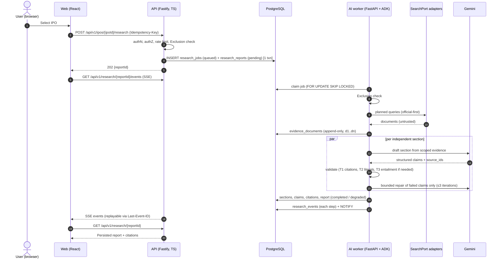

# Request Lifecycle

> Milestone 0 · Status: **design (not implemented)**
> Companion docs: [system-architecture.md](system-architecture.md), [source-provider-strategy.md](source-provider-strategy.md), [../security/threat-model.md](../security/threat-model.md)

This document follows one IPO research request from the moment a user picks an IPO to the moment a persisted, cited report is on screen. It then shows how Phase 2 stock monitoring reuses the same pipeline.

```
Company/IPO selection → Retrieval planner → SearchPort → Evidence ledger
  → Parallel research sections → Claim validation → Bounded repair
  → Report composition → SSE streaming → Persistent report
```

The core principle: **the LLM writes prose, deterministic code decides what is true.** The model never creates evidence, never computes money, and never marks its own claims as verified.

---

## 0. Overview sequence



---

## 1. Company / IPO selection

**What happens.** The user either searches (manual path) or browses AI discovery results. Both read the same `ipos` table, which the ingestion pipeline fills from official sources (see [source-provider-strategy.md](source-provider-strategy.md)). Discovery is **not** a live LLM web search per page view. It is a scheduled, validated ingestion job.

The user clicks **Research**. The browser sends `POST /api/v1/ipos/{ipoId}/research` with an `Idempotency-Key` header.

**API responsibilities (TypeScript, Fastify):**

1. **Authenticate** the session cookie and resolve `(user_id, tenant_id)` from the server-side session. Client-supplied IDs are ignored.
2. **Authorize**: the role must have the `research:create` permission.
3. **Rate limit** per user, per tenant, and per endpoint.
4. **Exclusion check #1** (see [ADR-0008](../decisions/0008-jio-exclusion-policy.md)). If the IPO is excluded or quarantined, return `403`/`451`-style problem JSON with code `ENTITY_EXCLUDED`. No job is created.
5. **Idempotency**: `(tenant_id, user_id, "research.create", ipoId, key)` maps to an existing `reportId` if seen before. A retried click never creates two jobs.
6. **One transaction** inserts `research_reports(status=pending)` and `research_jobs(status=queued)`.
7. Respond `202 Accepted` with `{ reportId, eventsUrl }`.

**Why the API doesn't call the AI service synchronously.** A research run takes minutes. A durable job row survives restarts, can be retried safely, and decouples the user's HTTP connection from the work ([ADR-0004](../decisions/0004-postgres-and-job-queue.md)).

## 2. IPO snapshot (before any research)

The AI worker claims the job with `SELECT … FOR UPDATE SKIP LOCKED`. It then:

1. **Exclusion check #2** (defence in depth; the worker never trusts that the API checked).
2. Builds a **versioned `ipo_snapshot`**. Each critical field (dates, price band, lot size, issue size, fresh issue/OFS split, status) is stored as `{value, source_evidence_id, checked_at, authority}`. A missing field is stored as `unverified`, never guessed.
3. Pins the report to `snapshot_id`. If the IPO data changes later, the old report stays reproducible because it points at its own snapshot.
4. If the snapshot shows the issue as **withdrawn/postponed**, research still runs (it is educational), but the report and calculator say so prominently.

## 3. Retrieval planner

A **deterministic-first** component decides what evidence each section needs.

- Input: snapshot + section catalogue (A–J from the brief).
- Output: a typed `RetrievalPlan`. Each `SectionPlan` names the required evidence kinds (e.g. "RHP: Restated financial information", "Exchange: issue notice") and the first-pass queries, ordered by the **source hierarchy**:
  1. Exchange disclosures (NSE/BSE) and issuer filings for issue details.
  2. SEBI offer documents (DRHP/RHP) and circulars for regulatory facts.
  3. Audited / restated financials inside the prospectus.
  4. Licensed or official market data.
  5. Credible news, for context only.
  6. Unofficial sources such as GMP, clearly labelled and off by default.
- The planner **dedupes** queries across sections. Sections B, C and E all need the RHP financials, so the RHP is fetched once.
- An LLM may *suggest* extra queries for the bounded broader round (step 5 below), but suggestions go through the same allowlist and budget.

## 4. SearchPort

`SearchPort` is the only path to the outside world. Each adapter implements the same interface:

```python
class SearchPort(Protocol):
    async def search(self, q: Query, ctx: RetrievalContext) -> list[SourceHit]: ...
    async def fetch(self, hit: SourceHit, ctx: RetrievalContext) -> FetchedDocument: ...
```

Every adapter is wrapped by the same reliability and safety middleware:

| Concern | Control |
|---|---|
| Rate limits | Per-provider token bucket that honours `Retry-After` |
| Failures | Timeout → retry (transient only, exponential backoff + jitter, max N) → circuit breaker |
| SSRF | Domain allowlist per provider, DNS resolution checked against private ranges, no redirect off-allowlist, size and content-type limits |
| Cost | Request counted against job and daily budgets |
| Exclusion | Exclusion check #3: hits primarily about an excluded entity are dropped and logged |
| Tests | `MockSearchPort` replays synthetic fixtures for deterministic tests |

Returned content is **untrusted data**. It may contain prompt injections ("ignore previous instructions…"). It is never concatenated into system prompts and never authorizes a tool.

## 5. Evidence ledger

Only the ingestion layer writes here. Agents get **read-only** handles.

- Each fetched document becomes an append-only `evidence_documents` row with a stable report-scoped ID (`d1`, `d2`, …) mapped to a global content hash. The same RHP fetched twice is one document version.
- Large documents (RHPs run to hundreds of pages) are parsed into **page-anchored passages** (`d3#p147`). Scanned pages go through OCR, and the OCR confidence is stored.
- Each record carries: URL, title, publisher, publication date, retrieval timestamp, hash, page/section, source type, authority class, freshness, and retrieval method.
- **Coverage evaluation** runs after the first pass. For each `SectionPlan`, did we get the required evidence kinds from an acceptable authority level?
  - Yes → proceed.
  - No → **one** bounded broader retrieval round, then proceed with whatever exists. The section may end up `degraded` or `unavailable`, which is the honest outcome.

## 6. Parallel research sections

The orchestrator (Google ADK, [ADR-0003](../decisions/0003-google-adk-orchestration.md)) fans out the independent sections. Each section agent:

- Receives **only** the passages relevant to that section. It never gets the whole RHP. This saves tokens and limits injection surface.
- Must return a typed `SectionDraft`. Every factual sentence is a `Claim{text, source_ids[], claim_type, values[]}`. Numbers are emitted as structured values (`{amount, unit, scale, currency, period, basis}`) as well as prose.
- Never computes derived metrics. P/E, growth rates, margins and market cap come from the deterministic **metrics engine** using validated inputs, and the formula is recorded.

Dependency ordering: D (issue structure) and B (financials) feed C (valuation), and everything feeds J (summary). These run in dependency waves rather than all at once. Concurrency is capped per provider (Gemini RPM/TPM) and per job.

## 7. Claim validation (deterministic-first)

Run against every claim ([ADR-0009](../decisions/0009-deterministic-first-validation.md)):

| Tier | Check | Implementation |
|---|---|---|
| **T1 citation integrity** | Claim has source IDs; every ID exists in *this report's* ledger; the cited passage is retrievable | Pure Python |
| **T2 literal grounding** | Every number, date, %, ₹ amount, share count and price band in the claim appears in the cited passage *with matching unit, scale (lakh/crore/million/billion), period, and basis (consolidated vs standalone)*; derived values are recomputed | Pure Python normalizer + metrics engine |
| **T3 semantic entailment** | Only when T1+T2 pass but prose meaning is uncertain. A small, bounded model call labels the claim `supported / partial / contradicted / not_supported / insufficient` | Gemini (small model), temperature 0, schema-constrained |

Claims that fail are **quarantined** with a structured reason (e.g. `T2_SCALE_MISMATCH: claim says ₹9.4 billion, d3#p147 says ₹9.4 crore`).

## 8. Bounded repair

For a section with quarantined claims, the repair controller:

1. Sends the drafter **only** the failed claims, their validation feedback, and the same scoped evidence.
2. Gets a redraft of those claims.
3. Revalidates with the **full** validator. The repairer can never approve its own output.
4. Stops when any limit is hit: **max 3 draft/repair iterations per section**, the section deadline, no improvement versus the previous iteration, or token/cost budget exhausted.

Anything still failing is **dropped or shown as "Unavailable"**. It is never promoted to verified because the loop ended.

Section result: `ok` (all required claims pass) · `degraded` (useful but incomplete) · `unavailable`. The UI shows these as **Verified · Partial · Not found**.

## 9. Report composition

The composer is mostly deterministic:

- Orders sections, attaches citations, builds the source panel, and lists missing information per section.
- Section J (summary) is drafted **from already-validated claims only**, then validated again.
- Adds fixed educational disclaimers ("not investment advice", "allotment not guaranteed", GMP caveats if GMP is shown).
- Computes **overall evidence confidence** from section states and source authority. This is a rule-based score, not an LLM opinion.
- Writes report, sections, claims and citations in one transaction, idempotently keyed on `(job_id, section, attempt)`, so a restarted worker can't duplicate rows.

## 10. SSE streaming

Progress is a **durable event log**, not an in-memory stream ([ADR-0005](../decisions/0005-sse-durable-event-log.md)):

- The worker appends `research_events(report_id, seq, type, payload)` and issues `NOTIFY research_events`.
- `GET /api/v1/research/{reportId}/events` (API, after authZ) replays events with `seq > Last-Event-ID`, then tails new ones.
- If the browser disconnects or the user navigates away, the job keeps running. On reconnect, the client resumes from its last event. A reload after completion shows the final state.
- Event types: `job.started`, `snapshot.created`, `section.retrieving`, `evidence.added` (count only), `section.drafting`, `section.validating`, `section.repairing{iteration}`, `section.completed{status}`, `job.completed{status}`, `job.failed{reason}`, plus heartbeat comments every 15 s.
- Payloads carry **no secrets and no raw source text**. They are status metadata only.

## 11. Persistent report

- `GET /api/v1/research/{reportId}` returns the persisted report. The API checks that `tenant_id` and ownership match the session; RLS enforces the same at the database.
- `GET …/evidence` returns permitted evidence references (metadata, passages, links to original URLs, and page references).
- Reports are immutable once completed. A "refresh" creates a **new** report linked to a new snapshot, and history keeps both.
- `DELETE` follows the retention policy: soft-delete, then purge after the retention window. Evidence shared across tenants (public filings) is retained separately from the tenant's report.

---

## Failure handling along the path

| Failure | Behaviour |
|---|---|
| Duplicate click / network retry | Idempotency key returns the same `reportId` |
| Worker crash mid-job | Lease expires → job reclaimed → completed sections are skipped (checkpointed) → idempotent writes |
| Provider outage | Retries → circuit opens → section degrades with reason `PROVIDER_UNAVAILABLE` |
| Gemini timeout / invalid JSON | Schema validation fails → bounded retry → section degraded |
| Budget exhausted | Stop drafting; publish what passed validation; mark the rest unavailable |
| Exclusion hit at any layer | Job → `rejected_excluded`; no research content generated; audit event |
| SSE drop | Client reconnects with `Last-Event-ID` |
| Job exceeds wall-clock deadline | Cancel outstanding calls; compose from completed sections; `completed_degraded` |

---

## Phase 2: how stock monitoring extends this pipeline

Stock monitoring reuses the **same backbone**: SearchPort, the evidence ledger, the validator, the job queue, and the event log. It adds a scheduler and a different set of agents.

```mermaid
flowchart LR
    S[Scheduler<br/>daily per market calendar] --> J[monitoring_jobs<br/>one per stock per window]
    J --> R[Retrieval planner<br/>stock profile]
    R --> SP[SearchPort<br/>exchange announcements, news, prices]
    SP --> L[Evidence ledger]
    L --> D[Dedup<br/>canonical URL + content fingerprint + event clustering]
    D --> C[Event classifier<br/>small model / rules]
    C --> N[Stock News Agent<br/>grounded summary]
    N --> V[Validator<br/>same T1/T2/T3]
    V --> X[Impact Explainer<br/>labelled as interpretation]
    X --> DG[Daily digest]
    DG --> AL[Alert evaluator<br/>deterministic rules]
    AL --> NT[notification_jobs<br/>idempotent]
```



What changes:

1. **Trigger.** The trigger is a scheduler, not a user click. It runs per stock (deduplicated across users: one fetch for INFY serves every tenant watching INFY) over a monitoring window `[last_successful_checkpoint, now)`.
2. **Unit of work.** A `monitoring_job(stock_id, window)` has a unique constraint, so reruns are no-ops.
3. **Dedup and clustering.** Five articles about one results announcement are clustered into **one event**. Repeated coverage is not counted as independent confirmation.
4. **Two kinds of output, kept separate.** *Reported facts* go through the validator. The *impact explanation* is stored and labelled as AI interpretation and still must cite the facts it reasons from.
5. **Fan-out to users.** Shared public evidence and events are joined to each user's own holdings, watchlist and wishlist (separate entities, tenant-scoped). Alerts are evaluated **deterministically** against the user's configured conditions. Notifications are keyed `(alert_id, event_id)`, so a scheduler restart never sends twice.
6. **Honesty about freshness.** The digest shows each provider's delay class (end-of-day, delayed, periodic) and flags incomplete windows ("BSE announcements feed failed 06:00–07:00; retried 3×").
7. **Exclusion.** Monitoring jobs and notifications also pass the exclusion policy (see [ADR-0008](../decisions/0008-jio-exclusion-policy.md) for the listed-stock open question).
