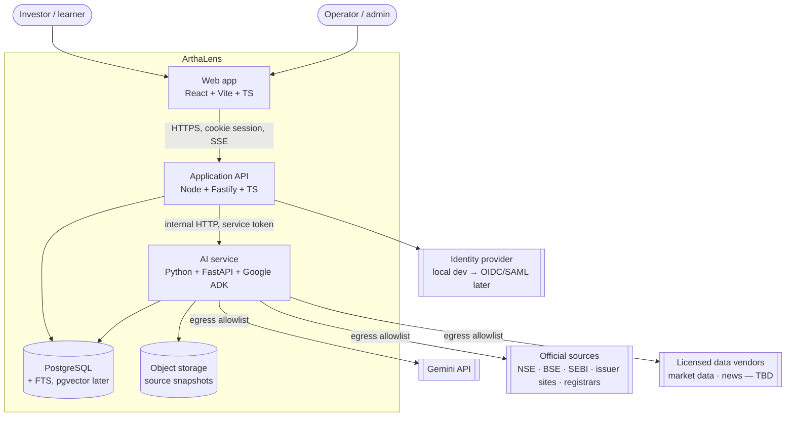
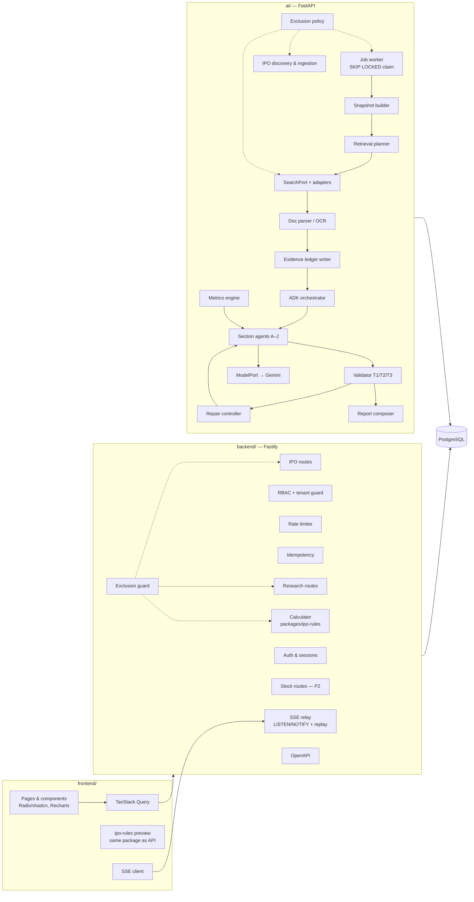
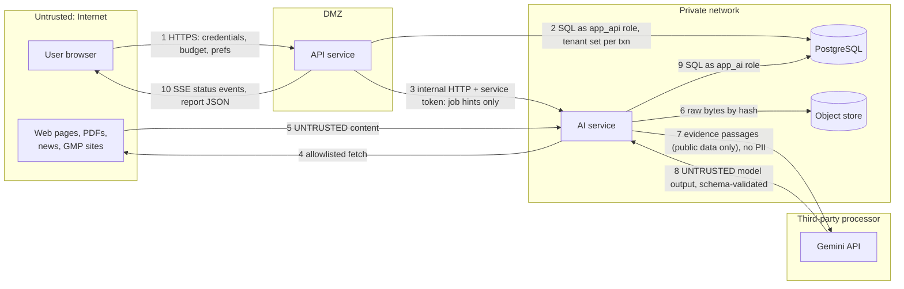

# System Architecture

> Milestone 0 · Status: **design (not implemented)**

## 1. Context diagram



**Only the AI service talks to the internet** (models and sources), and only through allowlisted egress. The API service has no outbound access other than the IdP. This makes SSRF and data-exfiltration analysis much simpler.

## 2. Container / component diagram



## 3. Service responsibilities

| Service | Owns | Does **not** own |
|---|---|---|
| **frontend/** | UI, accessibility, client-side validation (Zod), live calculator *preview*, SSE rendering, safe rendering of untrusted text | Any authoritative decision; it can't see secrets |
| **backend/** (TS) | Public `/api/v1` surface, OpenAPI, authentication, sessions, RBAC, tenant scoping, rate limits, idempotency, research-job *creation*, SSE relay, **authoritative calculator**, portfolio/watchlist/wishlist/alerts CRUD, scheduled-job management (config), audit events for user actions | Retrieval, LLM calls, evidence creation, validation |
| **ai/** (Python) | Job execution, IPO discovery/ingestion, snapshots, retrieval planning, SearchPort adapters, document parsing/OCR, **evidence ledger writes**, ADK orchestration, metrics engine (financial ratios), validator, repair, report composition, research events, monitoring pipeline (P2) | User identity, sessions, public HTTP exposure |
| **PostgreSQL** | System of record, job queue, event log, RLS tenant isolation, FTS | — |
| **Object storage** | Raw source snapshots (PDFs, HTML) where licence permits; keyed by content hash | — |

### Single owner per rule (no duplicated domain logic)

| Rule | Single implementation | Consumed by |
|---|---|---|
| Lot/bid/budget calculation | `packages/ipo-rules` (TS, integer paise) | web (preview), api (authoritative) |
| Financial metrics (P/E, margins, growth) | `ai/arthalens_ai/metrics` (Python `Decimal`) | section agents, validator |
| Number normalization & grounding | `ai/arthalens_ai/validation` | validator only |
| Jio exclusion **rules** | `packages/policy/exclusions.v1.json` (data) + shared test vectors | Small matchers in TS and Python, both tested against the **same vectors** ([ADR-0008](../decisions/0008-jio-exclusion-policy.md)) |
| API/AI contracts | Pydantic models → JSON Schema → generated TS types in `packages/contracts` | api, ai |

### Table write ownership

To avoid two services racing on the same rows, each table has one writer service. The other service may read, enforced by separate DB roles.

| Writer | Tables |
|---|---|
| api | `users`, `tenants`, `memberships`, `roles`, `permissions`, `research_jobs` (insert/cancel), `research_reports` (insert/delete), `ipo_calculation_scenarios`, `watchlist_items`, `holdings`, `wishlist_items`, `alerts`, `idempotency_keys`, `audit_events` (user actions) |
| ai | `ipos`, `ipo_snapshots`, `quarantined_entities`, `evidence_documents`, `evidence_contents` and `evidence_passages` (only via `evidence_put_content`), `evidence_retrievals`, `evidence_sets`, `evidence_set_items`, `evidence_claims`, `claim_citations`, `research_sections`, `research_events`, `financial_metrics`, `research_jobs` (status transitions), `research_reports` (completion), `stocks`, `stock_news`, `price_snapshots`, `notification_jobs`, `usage_records`, `evaluation_runs` |

## 4. Data-flow diagram (trust boundaries)



Data classification:

| Class | Examples | Rules |
|---|---|---|
| **Secret** | Gemini key, DB passwords, session secret, provider creds | Env/secret store only; never logged, never sent to the model, never sent to the browser |
| **Personal financial** | Holdings quantity, avg price, per-IPO budget, alerts | Tenant-scoped + RLS; never sent to Gemini; minimised in logs |
| **Personal identity** | Email, name | Tenant-scoped; never sent to Gemini |
| **Public source data** | RHP text, exchange notices | May be sent to Gemini (scoped passages); shared cache across tenants |
| **Derived research** | Reports, claims | Tenant-scoped ownership; built from public data |

> Budget values used by the calculator never leave the API service. The AI service does not need them.

## 5. Deployment views

**Local (implemented in Milestone 1):** Docker Compose runs `postgres` (17, roles created on first start), `migrate` (one-shot dbmate job), `ai` (FastAPI), `backend` (Fastify) and `frontend` (nginx serving the build and proxying `/api`). All ports bind to 127.0.0.1. No Redis. `ai-worker` joins in M4 and object storage when source snapshots are stored ([ADR-0014](../decisions/0014-milestone-1-implementation-refinements.md)). Mock providers will be on by default, with live providers behind explicit env flags. Milestone 3 added Tesseract to the `ai` image, an `evidence` volume for write-once source snapshots, and an `ai-test` service (profile `test`) that runs the full Python suite.

**Production (Milestone 11):** container images → private registry; Helm chart; Terraform for managed Postgres, object storage, secret manager, and egress firewall (allowlist). API is horizontally scaled behind a load balancer. AI workers scale on queue depth. A Redis tier is added only if measured rate-limit or cache contention justifies it ([ADR-0004](../decisions/0004-postgres-and-job-queue.md)).

## 6. Repository structure (planned; created in Milestone 1)

```text
ArthaLens/
├── frontend/                    # React + Vite + TS (web UI)
├── backend/                     # Node + Fastify + TS (public application API)
├── ai/                          # Python + FastAPI + ADK (worker + internal API)
│   ├── arthalens_ai/
│   │   ├── ingestion/           # discovery, SearchPort, adapters, parsing
│   │   ├── ledger/              # evidence ledger (write side)
│   │   ├── research/            # ADK orchestrator, section agents, prompts/ (versioned)
│   │   ├── metrics/             # deterministic financial formulas
│   │   ├── validation/          # T1/T2/T3, normalizer, repair controller
│   │   ├── policy/              # exclusion matcher
│   │   └── worker/              # job claim loop, checkpointing
│   └── tests/
├── packages/
│   ├── contracts/               # generated TS types + JSON Schemas + OpenAPI
│   ├── ipo-rules/               # calculator (TS, integer paise) — shared frontend/backend
│   └── policy/                  # exclusions.v1.json + test vectors (language-neutral)
├── database/
│   ├── migrations/              # SQL-first (dbmate)
│   └── seeds/                   # SYNTHETIC fixtures only, clearly labelled
├── infrastructure/
│   ├── docker/
│   ├── terraform/               # Milestone 11
│   └── helm/                    # Milestone 11
├── tests/
│   ├── integration/
│   ├── e2e/                     # Playwright
│   └── evaluation/              # golden datasets, eval harness
├── docs/
│   ├── architecture/  security/  decisions/  runbooks/
│   ├── PROJECT_BRIEF.md  requirements.md  acceptance-criteria.md  CHECKLIST.md
├── docker-compose.yml
├── .env.example                 # placeholders only
├── .gitignore                   # includes .env
└── README.md
```

## 7. Development commands

Implemented in Milestone 1. The full guide is in [../runbooks/local-development.md](../runbooks/local-development.md).

| Purpose | Command |
|---|---|
| Install | `corepack enable pnpm` · `pnpm install` · `uv sync --project ai` |
| Create local secrets | `pnpm env:init` |
| Start everything | `docker compose up --build -d` |
| End-to-end check | `pnpm smoke` |
| Health | `curl localhost:3000/readyz` · `curl localhost:8000/readyz` |
| TS checks | `pnpm typecheck` · `pnpm lint` · `pnpm test` |
| Python checks | `cd ai && uv run ruff check . && uv run mypy arthalens_ai tests && uv run pytest` |
| Migration roundtrip | `sh scripts/check-migrations.sh` |
| Generate / check contracts | `pnpm contracts:gen` · `pnpm contracts:check` |
| Secret scan | `pnpm secrets:scan` |

## 8. Why a hybrid TypeScript + Python design

Short version. The full reasoning is in [ADR-0001](../decisions/0001-hybrid-typescript-python.md).

- **Python is where the AI and document tooling is.** Google ADK is Python-first. PDF/OCR extraction (PyMuPDF, pdfplumber, OCRmyPDF/Tesseract), `Decimal` maths, and Pydantic structured outputs are mature there.
- **TypeScript is where the web is.** One language for UI and API means one set of Zod schemas and a shared calculator package between browser preview and server authority. Fastify and OpenAPI give a strong typed edge.
- **The boundary is meaningful, not arbitrary.** The API owns *who you are and what you may touch*. The AI service owns *what is true and how we know*. Separating them keeps users' personal financial data out of the process that talks to LLMs and the open web.
- **Cost:** two toolchains and contract drift. Mitigated by generated contracts, contract tests in CI, and the single-owner-per-rule table above.

## 9. Why Google ADK

Full reasoning in [ADR-0003](../decisions/0003-google-adk-orchestration.md). ADK gives us composable workflow agents (sequential, parallel, loop) with typed tool definitions and native Gemini integration. Those map directly onto *fan-out sections* and *bounded repair loops*. We use it as the **orchestration runtime only**. Retrieval, ledger writes, metrics and validation are plain deterministic Python that ADK calls, and the whole thing sits behind our own `ResearchRuntime` interface so ADK churn or a provider change doesn't leak into the domain.
